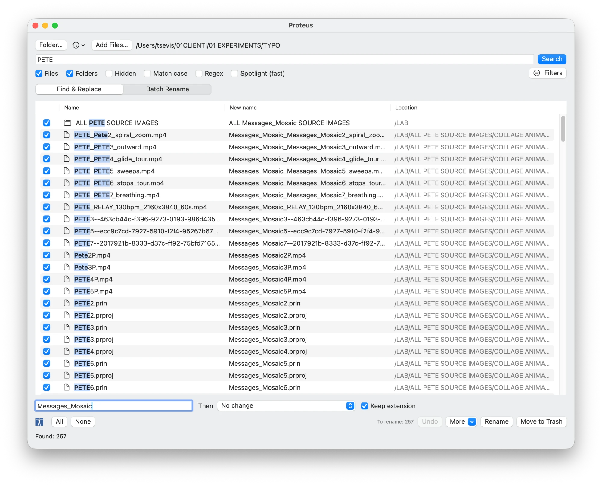
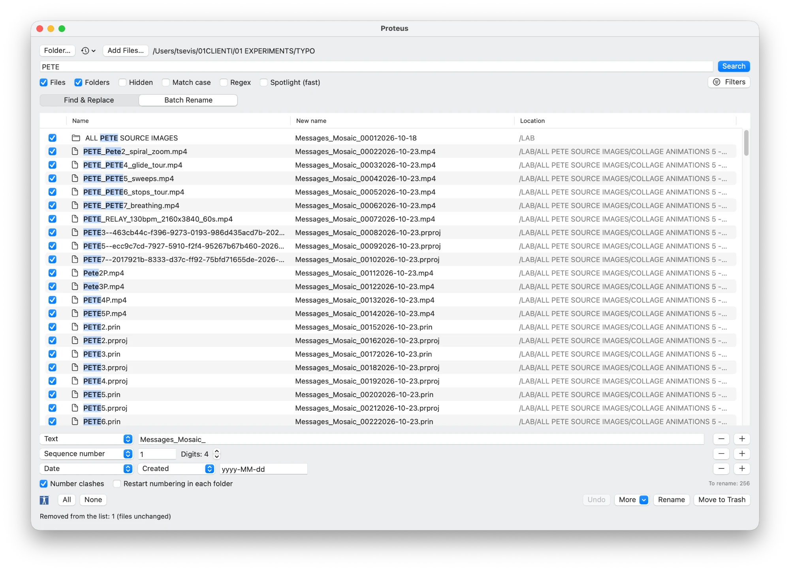
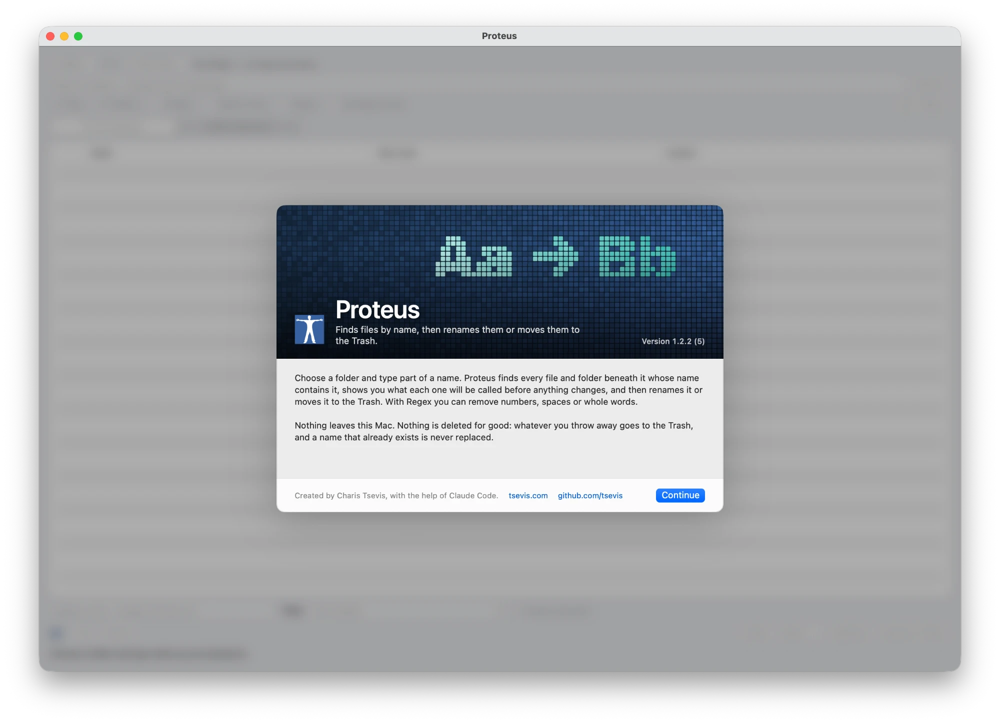

# Proteus

A native macOS app that finds files and folders by name, shows you what each
one will be called, and then renames them or moves them to the Trash. Named
after **Proteus**, the sea god who could change his shape at will.



**Status: in use.** Signed with a Developer ID, hardened, and **notarised by
Apple**. English, Greek, Italian, German and Ukrainian.

---

## What it does

Choose a folder, type part of a name, press **Search**. Every matching file and
folder below it appears in a table with three columns: its name, with the
matched text highlighted; the **new name** it will get; and where it lives.
Nothing on disk changes until you press **Rename** or **Move to Trash** and
confirm.

There are two ways to say what the new name should be.

### Find & Replace

Replace the text you searched for with something else, or with nothing to
remove it. Then, if you like, apply a ready-made transform to the whole name:

| Transform | `Γιάννης Logo Final.PNG` becomes (Keep extension off) |
|---|---|
| lowercase | `γιάννης logo final.png` |
| UPPERCASE | `ΓΙΆΝΝΗΣ LOGO FINAL.PNG` |
| Title Case | `Γιάννης Logo Final.PNG` |
| Web slug | `giannis-logo-final.png` |
| Greek/Cyrillic to Latin | `Giannis Logo Final.PNG` |
| Remove accents | `Γιαννης Logo Final.PNG` |
| Spaces to dashes / underscores | `Γιάννης-Logo-Final.PNG` |

**Keep extension** (on by default) leaves `.jpg`, `.psd` and the rest exactly as
they are. With it off, lowercase and the web slug also lowercase the extension. **Regex** turns the search into a regular expression, and the
replacement can then use `$1`, `$2`… for captured groups.

### Batch Rename

Build the new name from a stack of rows, in the manner of Adobe Bridge. Add a
row with **+**, remove it with **−**; rows apply from top to bottom.



| Row | Adds |
|---|---|
| Text | Any text you type |
| Current name | The name as it is, without its extension |
| Sequence number | 1, 2, 3… from any start, padded to 1–9 digits |
| Sequence letter | a, b, … z, aa, ab… |
| Date | Created, modified or **photo taken** (from EXIF), in any format such as `yyyy-MM-dd` |
| Folder name | The name of the folder the item is in |
| Find and replace | Rewrites the name built so far |
| Transform | Applies one of the transforms above to the name built so far |
| New extension | Replaces the extension |

**Number clashes** adds ` 2`, ` 3`… when two items would end up with the same
name; numbered names are shown in orange. **Restart numbering in each folder**
starts the sequence again in every folder.

## Filling the list

- **Search a folder.** **Folder…**, or drop a folder on the window or on the
  Dock icon, or right-click a folder in Finder and choose **Services ▸ Rename
  with Proteus**. An **empty name field lists everything** in the folder,
  which is what you want for a batch rename. The clock menu holds recent
  folders.
- **Add items by hand.** **Add Files…**, or drag files and folders from Finder
  onto the list. A folder added this way is renamed itself, not searched.
  Hand-picked items stay in the list across searches.
- **Narrow it down.** Choose **Files** and **Folders**, include **Hidden**
  items, **Match case**, or open **Filters** to keep only certain extensions
  (`jpg, psd, ai`), a size range, a modified-date range or a Finder tag.
  **Spotlight (fast)** searches the Spotlight index instead of walking the
  folder: much faster on a big tree, but only as complete as the index.
- **Take things out.** Uncheck a row to leave it alone, or right-click ▸
  **Remove from List** (or press Delete) to drop it from the list. Neither
  touches the file.

Right-click a row for **Quick Look** (or press Space), **Reveal in Finder** and
**Open**. **More** adds or removes a **Finder tag** on the checked items,
**exports the list as CSV** (path, name, new name, and whether each will be
renamed), and clears the list.

## Safety

Proteus changes file names, so it is built to refuse rather than guess.

- **Everything is previewed.** The table shows the name each item will
  actually get, including any number added to avoid a clash. An item that
  cannot be renamed is shown in red with the reason: the name is already
  taken, two checked items would get the same name, the name would start with
  a dot and hide the file, or it is too long.
- **Undo.** **Undo** (or ⌥⌘Z) puts back the last rename or Trash: every item
  returns to its previous name and place. The record survives quitting the
  app. Anything changed since is left alone.
- **Nothing is overwritten.** A rename never replaces an existing file, and
  every item is checked again on disk just before it is renamed. If something
  else has taken its place since the search, it is skipped.
- **Nothing is deleted for good.** Move to Trash means the Trash. It is
  disabled when the search is empty, so one click can never throw away a whole
  folder.
- **Packages stay closed.** Apps, Photos libraries, Final Cut libraries and
  other packages are treated as single items. Proteus never looks or renames
  inside them, and refuses one as the folder to search. The same goes for
  `.git` and the system's hidden folders.
- **Folders and their contents rename together.** Items are renamed deepest
  first, so renaming a folder never breaks the paths of the items inside it.
- **Greek names written on other systems** (decomposed Unicode) are matched
  like any others.
- **Nothing leaves this Mac.** No network access, no analytics.

## Building

Requires macOS 15 and Swift 6.

```bash
swift test
```

```bash
./build_app.sh
```

builds `Proteus.app` next to the script, ad-hoc signed.

```bash
./Scripts/sign-and-notarize.sh
```

signs it with a Developer ID, notarises it with Apple and staples the ticket.

The code is split into **ProteusCore**, which holds the matching, transforms,
rename planning, undo journal and scanning with no UI, and the **Proteus**
SwiftUI app. The tests cover the core, on throwaway files in a temporary
folder.

Translations live in `tools/translations.py` and `tools/translations_v11.py`.
English is the source language; `python3 tools/translations.py` regenerates
the `.strings` files. The app icon and splash art are drawn by
`tools/make_artwork.swift`.



---

Created by **Charis Tsevis** ([tsevis.com](https://tsevis.com)), with the help
of Claude Code.
